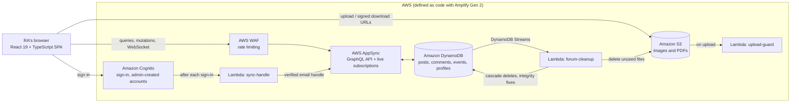

# ResLink

**The operations hub for a residence-hall staff.** A team of Resident Assistants keeps a building of students safe, informed and connected. They run programs, respond to incidents, track building issues and cover each other's shifts. Before ResLink, that work was spread across Google Calendar, Calendly, iMessage group chats and email. Meanwhile, head staff were so stretched that staff meetings got cut short, and important items went unaddressed or were forgotten entirely.

ResLink puts everything in one place: a staff forum that tracks what each RA has read, so the team can hold each other accountable; a shared operations calendar; and staff profiles. It is one central source of truth the whole staff can collaborate in, instead of five apps nobody fully checks. Only the hall's own staff can sign in. Every account is created by an administrator, and every record is protected by rules the server enforces, not just the UI.

Built as a full-stack, serverless web app with React 19 and TypeScript on AWS Amplify Gen 2. The entire backend (auth, database, API, storage, functions and firewall) is defined as TypeScript in this repository.

---

## Architecture



| Piece | What it does | Why this choice |
| --- | --- | --- |
| **React + TypeScript (Vite)** | The single-page app RAs use. | Components and hooks keep a live, interactive UI manageable. Types generated from the backend schema mean a backend change that breaks the UI fails at compile time, not in front of a user. |
| **AWS Amplify Gen 2** | Defines and deploys the whole backend from TypeScript. | One language from database rule to button. Every RA permission is reviewable in a pull request, and each developer gets an isolated cloud sandbox. |
| **Amazon Cognito** | Sign-in and identity. | Managed, hardened authentication. Self sign-up is switched off in the user pool itself, so only accounts an administrator creates can ever get in. |
| **AWS AppSync (GraphQL)** | The API between app and data. | Built-in WebSocket subscriptions make the forum live with no server to run. Authorization rules are attached to each model and field, so they are enforced on every request. |
| **Amazon DynamoDB** | Stores posts, comments, events, profiles and read receipts. | Serverless and pay-per-request: idle cost near zero for a staff-sized app. Secondary indexes give fast per-semester and per-post queries, and Streams let the backend react to changes. |
| **Amazon S3** | Stores header images, attachments, flyers and profile pictures. | Cheap, durable file storage. Each RA writes only to their own folder, and files are served through short-lived signed URLs rather than public links. |
| **AWS Lambda: forum-cleanup** | Runs on every post or comment insert and delete. | Each RA can only delete their *own* rows, so deleting a post can't safely clean up other people's comments from the browser. This function does the cascade server-side and checks new records for consistency. |
| **AWS Lambda: upload-guard** | Runs on every file upload. | Browser-side file checks can be bypassed. This enforces type and size limits server-side and confirms the file's bytes match its declared type. |
| **AWS Lambda: sync-handle** | Runs after each sign-in. | Records each RA's verified email handle, which only the server can write, so a chosen display name can never be used to impersonate a teammate. |
| **AWS WAF** | Sits in front of the API. | Per-IP rate limiting so a runaway script or abuse can't flood the staff's data. |

---

## Features

### Staff forum
- **Five purpose-built categories:** Building Updates, Programs & Events, RA Questions, General Announcements, and Lost & Found.
- **Live feed:** new posts, comments, pins and deletions reach every signed-in RA instantly, with no refresh.
- **Per-person read tracking:** Latest / Unread / Seen / Pinned tabs with live counts, so no one misses a building update.
- **Organised by semester:** the feed shows the current term, and earlier semesters are one click away.
- **Rich posts:** header image, up to five attachments (images or PDFs), and for events a date, time, location and flyer.
- **Threaded replies,** nested to any depth.
- **Editing and deleting:** authors edit, pin and delete their own posts, and edit or delete their own comments. Edits are labelled. A deleted comment that has replies leaves a placeholder so the conversation under it survives.

### Shared operations calendar
- Month grid and hourly week timeline, with previous / next / today navigation.
- Staff create, edit and delete events with attachments.
- **One source of truth:** every Programs & Events post appears on the calendar automatically, colour-coded and linked to its post, so an RA announces a program once and it shows up everywhere.

### Profiles
- Display name, birthday and profile picture for every RA, plus a verified `@handle` shown beside every name.
- An in-browser avatar cropper that stores the zoom and focus point as data, so the original photo is never re-encoded or degraded.

### Security
- Admin-created accounts only, with a 12-character minimum password.
- **Server-enforced permissions:** any RA can read, only the author can change, and authorship can't be forged or reassigned.
- **Server-checked uploads,** with per-user storage folders and expiring download links.
- **Rate limiting** on the API.

---

## Challenges and how I solved them

**1. Deleting a post left orphaned data behind.**
Comments and read receipts belong to whoever wrote them, so the post's author has no permission to delete them, and loosening that rule would let any RA delete anyone's content. *Solution:* a Lambda subscribed to the DynamoDB stream performs the cascade server-side with its own narrowly scoped permissions. It also removes "deleted comment" placeholders once their last reply is gone. A cleanup the browser was never allowed to do now runs on the server.

**2. The cleanup function could be turned against other users.**
A security review found that a post could list *another* RA's files as its attachments. Deleting that post would then have the cleanup function, which has broad delete rights, wipe the victim's files. This is a classic confused-deputy bug. *Solution:* the function now deletes a file only if no other post still references it, and only within the forum folder.

**3. Authorship was trusted to the client.**
Posts originally stored an `authorId` and `authorName` written by the browser, so a crafted request could post as someone else. *Solution:* authorship now comes from an `owner` field the backend stamps from the signed-in user's token, with a field-level rule that makes it unwritable. A second gap remained: display names are freely chosen. So a sign-in trigger records each RA's verified email handle, which is shown beside every name.

**4. Live data without race conditions.**
Loading data and then subscribing to changes leaves a window where a new record can be missed, and an out-of-order update can overwrite a newer one. *Solution:* every data hook subscribes *before* its initial fetch and merges incoming records by `updatedAt`, so nothing is dropped and stale copies never win.

**5. Load time that grows with history.**
Loading every post ever written works in week one and degrades every semester after. *Solution:* posts and comments carry their academic term and are queried one term at a time through DynamoDB secondary indexes. The calendar needs event posts from any month, so it uses a separate category index rather than the semester feed.

**6. Wiring serverless pieces without circular dependencies.**
Functions that both read a table and are triggered by it produced CloudFormation dependency cycles between stacks. *Solution:* each function is placed in the same resource group as the resources it touches, so dependencies only point one way.

---

## Tech stack

| | |
| --- | --- |
| **Frontend** | React 19 · TypeScript 5.9 · React Router 7 · CSS Modules |
| **Build & quality** | Vite 8 · ESLint 10 · typescript-eslint |
| **Backend** | AWS Amplify Gen 2 · AWS CDK |
| **API** | AWS AppSync (GraphQL, real-time subscriptions) |
| **Data** | Amazon DynamoDB (secondary indexes, Streams) |
| **Storage** | Amazon S3 |
| **Compute** | AWS Lambda (Node.js, AWS SDK v3) |
| **Auth & security** | Amazon Cognito · AWS WAF · IAM |

---

## Setup

**Prerequisites:** Node.js 20+ and an AWS account with credentials configured locally.

```bash
# 1. Install dependencies
npm install

# 2. Deploy your own cloud sandbox (writes amplify_outputs.json)
npx ampx sandbox

# 3. In a second terminal, start the app
npm run dev
```

Self sign-up is disabled, so create your first user in the Amazon Cognito console (User pools → your sandbox pool → Create user), then sign in with that email.

| Command | What it does |
| --- | --- |
| `npm run dev` | Start the dev server |
| `npm run build` | Type-check and build for production |
| `npm run lint` | Run ESLint |
| `npm run verify` | Pre-deploy gate: lockfile check, lint and build |

---

## Scale and impact

- **In use by a staff of 22 RAs.** It is their day-to-day channel for building updates, program planning and the shared operations calendar.
- **Serverless and pay-per-use:** there are no servers to run or patch, and running costs track actual usage, which keeps costs low for a residence-hall budget.
- **Built to last beyond one semester:** semester-scoped loading keeps the app fast as history accumulates, and server-side cleanup keeps the database free of orphaned data.
- **Security-reviewed:** the codebase went through a dedicated security pass. Every high- and medium-severity finding was fixed, including a confused-deputy bug, and production dependencies have no known vulnerabilities.

---

## What I learned

ResLink is a solo project: I designed, built, tested and shipped it myself.

**Start with the people who will use it.** ResLink began with a question rather than code. In a staff meeting I asked my fellow RAs what they would want in an RA app and what would actually make their jobs easier. Their answers set the feature list.

**Ship early, test live, iterate.** I ran a live test with the staff and have been iterating since. The feedback had no complaints, only requests for more, and those requests became the roadmap below.

**The problem was coordination, not a missing feature.** Every app the staff already used did its own job well. The cost came from switching between them. The most valuable thing ResLink does is put everything in one place.

**Learning a new framework on top of what I knew.** I had used AWS and DynamoDB in a previous internship, but this was my first time with Amplify. I started by building a simple notes app from the documentation to learn the CRUD patterns, then grew it into ResLink. The data modelling came naturally. Access rules and infrastructure as code took the longest to understand.

**Security has to live on the server.** I had always thought about security, but only on the client side. Building ResLink taught me that hiding a button protects nothing. Every rule has to be enforced by the backend, because anyone can send a request without the UI.

**AI speeds you up; checks keep you honest.** I used Claude to accelerate development and learned how much linting, type-checking, successful builds and real deployments matter. Code that looks right isn't done until it builds and deploys, so the project has a one-command `npm run verify` gate.

**Dependencies are part of the build.** Failed deployments taught me that code which runs on my machine isn't finished. The cloud build installs exactly what `package-lock.json` records, so the lock file has to match `package.json` precisely. One recurring failure traced back to npm quietly dropping packages that Amplify bundles inside its own libraries. I now treat the lock file as part of the code and run a clean install before every push.

**My proudest decision: Lambda.** Using Lambda functions on DynamoDB Streams for server-side cleanup was a full-circle moment, taking something I learned in my internship and applying it to a real problem in my own product.

**What I'd do differently:** choose a different styling approach from the start. CSS Modules worked, but styling took more effort than it needed to as the app grew.

---

## Future improvements

- **RA and head-staff dashboards:** an RA view of their own floor, programs and tasks, and a head-staff view across the whole building, with role-based permissions.
- **Internal messaging:** 1:1 and group conversations between staff, with read receipts.
- **AI assistant:** a chatbot that answers RA questions from the hall's own posts, policies and procedures, such as "what's the lockout procedure?" or "what programs are this month?".

---

## Author

Built by **Sadiq Mohammed** · [github.com/SadiqM05](https://github.com/SadiqM05)
